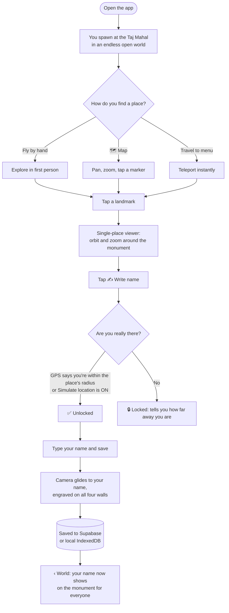

# 🗺️ Layover Marks

**Fly through a virtual India. Carve your name where you've really been.**

Layover Marks is a browsable 3D world of famous Indian places: the Taj Mahal, Qutub Minar, Hampi, Kanchenjunga and more. Visit one in real life and your phone's GPS unlocks the right to carve your name into it. Your mark then stays on the monument for everyone who flies past.

Built for a hackathon. Runs in the browser, nothing to install.

> 📦 **Code:** [github.com/fathima156/imprint](https://github.com/fathima156/imprint)
> 🔗 **Live demo:** (https://imprint-nmm4.onrender.com/)

- 📱 **Made for phones.** Touch joystick, pinch to zoom, no accounts needed to start.
- 📏 **Real scale.** 1 unit = 1 metre. Monuments are built at roughly their true size, and every place sits at its true latitude/longitude, so the distances between places are the real ones.
- 🔍 **Zoom until you can read it.** Fly up to a wall and zoom in far enough to read letters only a few centimetres tall.
- 📍 **Honest marks.** You can only carve a place you are standing at, and the app checks that with GPS.

---

## 📸 Project photos & demos

### 🎬 Demo
<!-- Paste a YouTube / Drive link, or drop a GIF into docs/demo/ and use  -->
- **Demo video:** _link coming soon_
- **Demo GIF:** _coming soon_
- **Presentation / slides:** _link coming soon_

### 🖼️ Project photos
<!--
  How to add photos:
  1. Put image files in docs/screenshots/ (e.g. docs/screenshots/world.png)
  2. Replace each "_Photo coming soon_" below with:
     
-->

| The open world | Taj Mahal up close |
|---|---|
| _Photo coming soon_ | _Photo coming soon_ |

| The map | Your name carved on a wall |
|---|---|
| _Photo coming soon_ | _Photo coming soon_ |

| GPS lock / unlock message | At a real place (field test) |
|---|---|
| _Photo coming soon_ | _Photo coming soon_ |

---

## 🚀 Quick start

```bash
git clone https://github.com/fathima156/imprint.git
cd imprint
npm install
npm run dev
```

Open the URL it prints (usually http://localhost:5173). That's it. With no setup, names are saved in your browser. To share names between devices, see [Storing names](#-storing-names-database).

---

## 🧭 How it works (the flow)



**In plain words:**

1. **Explore.** Fly around, open the map, or teleport. The places are up to ~1,500 km apart, so teleporting is the practical way to hop between them.
2. **Open a monument.** Tap it to inspect it up close.
3. **Prove you're there.** The app compares your phone's GPS to the place's real coordinates.
4. **Carve.** Write your name and watch the camera glide in to it.
5. **Come back anytime.** Your name is saved and appears on the monument in the open world.

---

## 👀 What you'll see

1. **An endless, all-land world.** Procedurally generated green landscape: light meadow low down, darker green and rocky ground on the peaks, under a sky with distance fog. There is no water anywhere, and the terrain streams in around you as you move.
2. **First-person flying, starting at the Taj Mahal.**
   - Drag (mouse or one finger) to look around.
   - **W A S D / arrow keys**, or the on-screen joystick on touch, to move.
   - **Shift** to sprint.
   - **Scroll / pinch** to zoom, all the way down to centimetre-sized detail (FOV to 1.2°, or about 15 cm at arm's reach).
   - The camera stays above the ground, so you travel along the surface.
3. **A scrollable map.** The **🗺 Map** button opens a top-down map of the whole world. Drag to pan, scroll or pinch to zoom, and tap a marker to fly straight to that monument. **Fit all** frames every place, and a green dot shows where you are.
4. **Fast travel.** The **Travel to** dropdown at the top teleports you to any place.
5. **Ten hand-built places at real metre scale.**

   | Place | What's modelled | Carving unlock radius |
   |---|---|---|
   | **Taj Mahal** | ≈ 73 m: plinth, iwans, onion dome, chhatris, ~40 m minarets | 150 m |
   | **Qutub Minar** | ≈ 72.5 m: five tapering fluted storeys with balconies | 120 m |
   | **Charminar** | ~56 m with four ~48.7 m corner minarets | 120 m |
   | **Konark Sun Temple** | ~39 m tower, twelve stone wheels per side, horses | 150 m |
   | **Gateway of India** | ~26 m basalt arch memorial | 120 m |
   | **Amber Fort** | ~100 × 60 m walled plateau with ramparts, bastions, palace | 200 m |
   | **Hampi** | ~50 m gopuram and the ~5 m Stone Chariot | 500 m |
   | **Rohtang Pass** | snow ridges flanking the pass, with the mountain road | 1,500 m |
   | **Kanchenjunga** | a great snow massif ridge line | 3,000 m |
   | **TinkerSpace Calicut** | ~7 m makerspace block at IPM, Kozhikode | 100 m |

   Every place has a floating name label.
6. **Tap a landmark** to open the single-place viewer, where you orbit and zoom around the monument. A drag is ignored, so flying around never opens one by accident.
7. **✍ Write your name.** A pad at the bottom of the single-place view. On save, the camera glides to the name so it's right in front of you. It is engraved (dark serif lettering with a light catch-edge) onto a band on **all four walls**, partway up and not on the foundation. The band is 1.2 to 6 m wide depending on the place, so letters stay small but read clearly as you zoom, and they stay crisp thanks to a high-resolution, heavily anisotropic texture. Names are saved to the database and shown on the monument in the open world, so your mark survives a reload.
8. **‹ World** returns to the open world and fully disposes the scene.
9. **Simulate location.** A demo toggle that treats you as standing at the place you're viewing, so you can show off carving without being there.

---

## 📍 Location & the carving rule

You can only carve a monument you are actually standing at. The app watches the device's GPS (`src/lib/location.ts`, a wrapper around the browser Geolocation API) and compares it to each place's real coordinates. Writing unlocks only when you are within that place's `radiusM`, using haversine distance (`isWithinRadius` in `src/lib/geo.ts`). So only people at the Taj Mahal can write on the Taj Mahal, and the same goes for every other place.

- The name pad explains why writing is locked, for example "You're 420 m from Taj Mahal…".
- Browsers only expose geolocation on a secure origin (**HTTPS or `localhost`**). On plain HTTP it's unavailable, so use **Simulate location** to demo carving anyway.

---

## 💾 Storing names (database)

Written names are saved so they survive a reload and appear on the monument in the world.

**Option 1: local, no setup (default).** Names are stored in an IndexedDB database on your device.

**Option 2: shared database with Supabase.**

1. Create a file named `.env.local` in the project root (it is git-ignored, so your keys are never committed) and add:
   ```
   VITE_SUPABASE_URL=https://xxxx.supabase.co
   VITE_SUPABASE_PUBLISHABLE_KEY=your-publishable-key
   ```
2. Run this in the Supabase **SQL Editor** to create the table:

   ```sql
   create table carvings (
     id bigint generated by default as identity primary key,
     place_id text not null,
     name text not null,
     created_at timestamptz not null default now()
   );
   create index carvings_place_id_idx on carvings (place_id);
   -- Demo-friendly access (tighten this for production):
   alter table carvings enable row level security;
   create policy "public read"   on carvings for select using (true);
   create policy "public insert" on carvings for insert with check (true);
   ```

Every name written becomes its own row, so a place keeps all its names and they stack up the wall in the order they were added. The client talks to Supabase's REST (PostgREST) endpoint with plain `fetch`, so no SDK dependency is needed.

> Only ever put the **publishable** key in the app. Never use a `service_role` or secret key in browser code.

---

## 📐 Scale model (for the curious)

- **1 world unit = 1 metre.**
- `latLngToWorld` (in `src/lib/geo.ts`) projects each place's real coordinates to metre positions relative to `WORLD_ORIGIN` (≈ central India) using an equirectangular projection, so distances between places are true.
- Places span up to ~1,500 km, so all world geometry lives under one `contentRoot` group whose position is set to the negative of the viewer every frame (**floating origin**). This keeps GPU float precision at a few centimetres however far from the origin you are, which is essential for carving real-size names.
- The renderer uses a **logarithmic depth buffer** with a 5 cm near plane and a 20 km far plane. The free-fly camera can pinch-zoom to a 1.2° FOV, enough to frame a few-centimetre-tall signature on a wall. In the single-place viewer the orbit can zoom to 15 cm from a surface.
- Monuments carry **true metre heights**. The three mountain and nature spots are **stylised relief** (the Kanchenjunga snow massif rises ~1,150 m, not 8,586 m) standing on broad highland anchors instead of their absolute elevations.

---

## 🗂️ Project structure

```
src/
  main.ts                    app entry, screen switching (world <-> single place)
  lib/geo.ts                 haversine + latLngToWorld (metre-accurate projection)
  lib/location.ts            GPS watching (browser Geolocation API wrapper)
  data/places.ts             Place interface, WORLD_ORIGIN, the 10 places
  world/SceneView.ts         shared renderer/scene/camera/lights/fog/dispose base
  world/FreeFlyControls.ts   first-person look + move + zoom + logical position
  world/terrain.ts           InfiniteTerrain: chunked all-land terrain streaming
  world/stone.ts             procedural stone from a seed (simplex-noise)
  world/models/              hand-built landmark models
    parts.ts                   shared parts (onion dome, arch, chhatri)
    TajMahal.ts, QutubMinar.ts, Charminar.ts, KonarkSunTemple.ts,
    GatewayOfIndia.ts, AmberFort.ts, Hampi.ts, RohtangPass.ts, Kanchenjunga.ts,
    TinkerSpaceCalicut.ts
    index.ts                   model registry (id -> builder)
  world/NamePlaque.ts        write-your-name on all four walls (high-res engraving)
  db/nameBackend.ts          storage backends: Supabase (REST) + IndexedDB
  db/names.ts                in-memory name cache + load/persist helpers
  world/WorldScene.ts        createWorld: contentRoot + real-positioned landmarks
  world/WorldViewer.ts       open-world view: free-fly + floating origin + travel
  world/SceneFactory.ts      SceneFactory.create(place) -> { scene, stoneMesh }
  world/PlaceViewer.ts       single-place view (OrbitControls; model or stone)
  ui/Joystick.ts             on-screen analogue stick for touch movement
  ui/WorldMap.ts             pannable, zoomable top-down map of all places
  ui/styles.css              mobile-first dark theme
```

---

## 🔧 Extending it

- `createWorld(scene, places): World` assembles terrain and landmarks under `contentRoot` and returns `heightAt(x, z)`, `update(viewerPosition)` (chunk streaming) and `dispose()`. Tune `WORLD_SEED` and `ANCHOR_SHAPES` to reshape the landscape and the hills under each monument.
- `FreeFlyControls`: `setMoveInput(x, y)` drives movement, `.position` holds the true-world viewer position (metres), `setPosition` / `lookAt` power fast travel, and `getGroundHeight` keeps the camera on the surface.
- `WorldViewer.travelTo(placeId)` is the fast-travel hook the top bar uses.
- `latLngToWorld(latitude, longitude, origin)` is the real-coordinate projection.
- `getLandmarkModel(placeId)` (in `models/index.ts`) is the model registry. Every current place has a hand-built model, and a new place needs one entry here.
- `PlaceViewer.writeName(name)` plus `db/names` (`signedNames`, `persistName`, `loadNames`) handle writing and storing names.
- `Place` (in `data/places.ts`) is the shape a database can later fill. All coordinates carry a `// TODO verify` note.

---

## ⚠️ Known limitations (on purpose, for now)

- **Not a real map.** The world is "endless" by streaming a repeating noise field. Only the landmark positions are real, and landmarks sit on stylised hills, not their true elevations.
- **Approximate sizes.** Monument dimensions are faithful but approximate. The real Amber Fort is far larger than the modelled central palace complex.
- **Placeholder coordinates.** Place coordinates are approximate until verified.
- **GPS can be spoofed.** The check confirms the phone reports a nearby position, not that the person is truly there. Stronger anti-spoofing is a later concern.
- **No accounts yet.** Names aren't tied to a signed-in user.
- **Stacked names.** A place keeps all its names stacked up the wall. Placing a mark exactly beside someone else's is not implemented.

---

## 👥 Team

**Team name:** The Nomads
**Hackathon:** Layover, 10-11 October 2026
**College / organisation:** TinkerHub x The Visa Guy

| Name | Role | Contact |
|---|---|---|
| Salha M Khalfan | Database, GPS & location | https://github.com/salhamkhalfan|
| Fathima Afrah Peedikaparamben | 3D world, UI & design | https://github.com/fathima156 |

